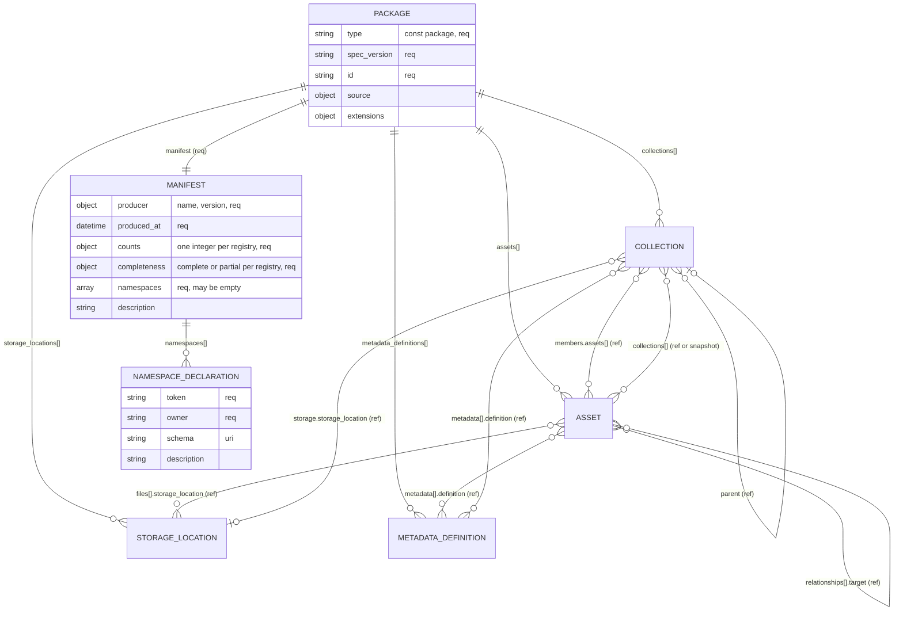
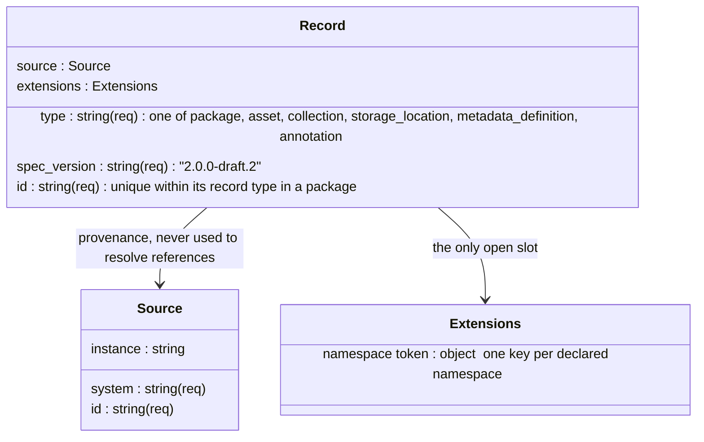
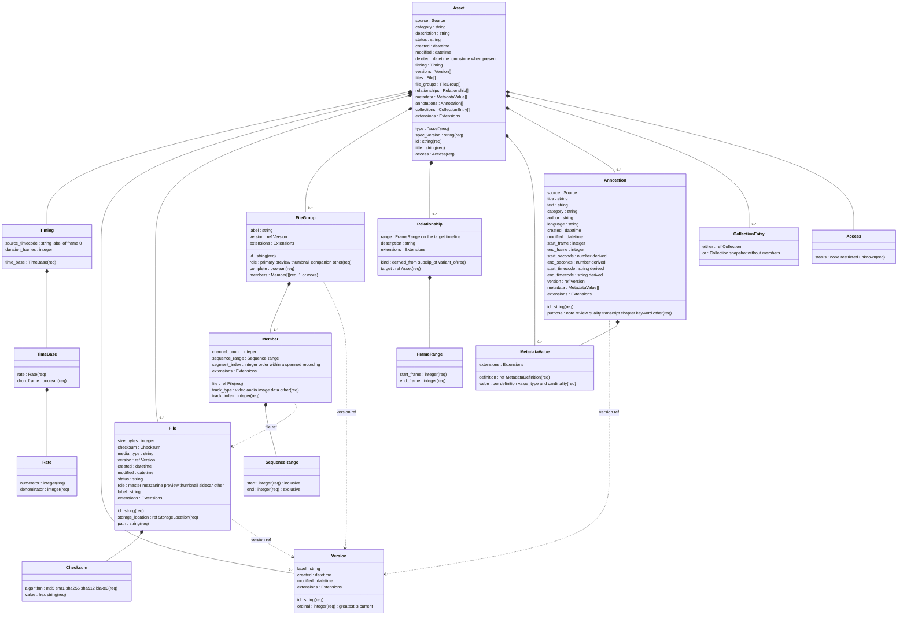
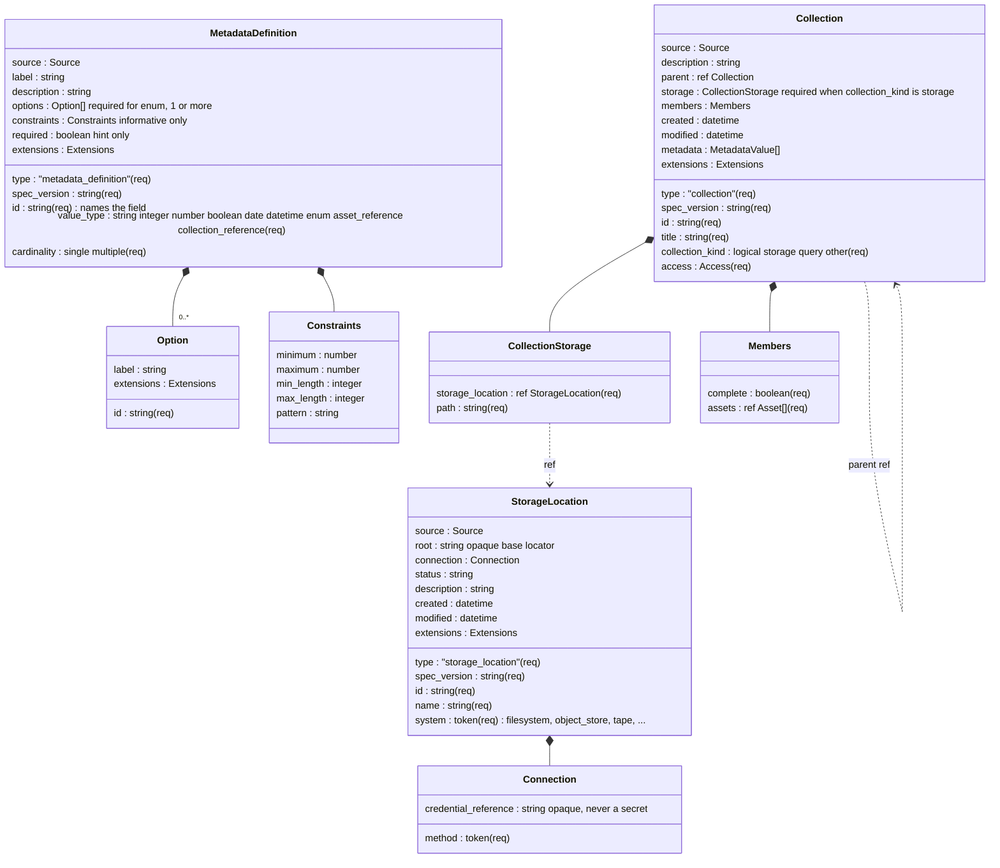
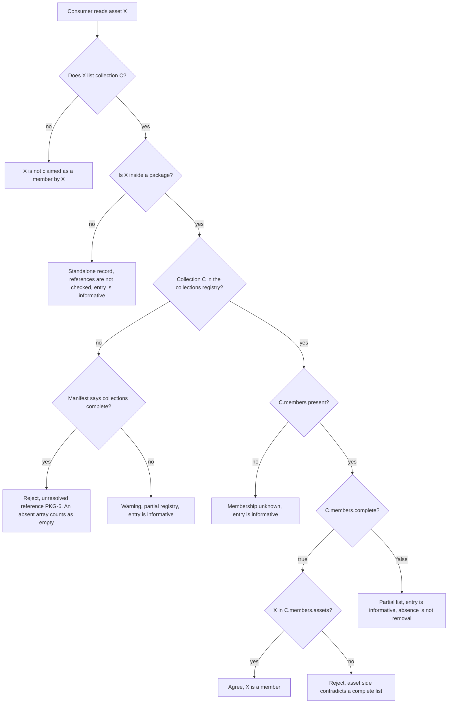
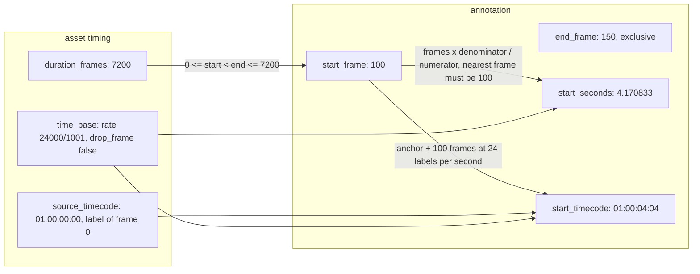
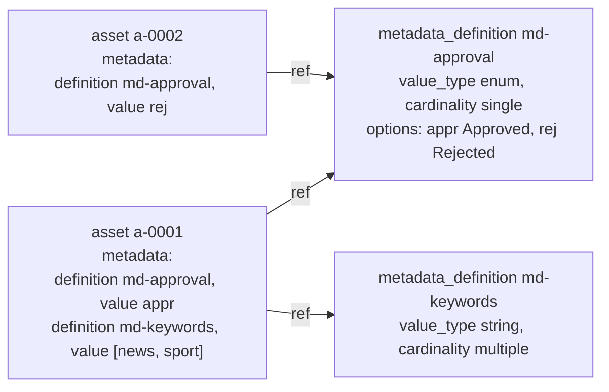
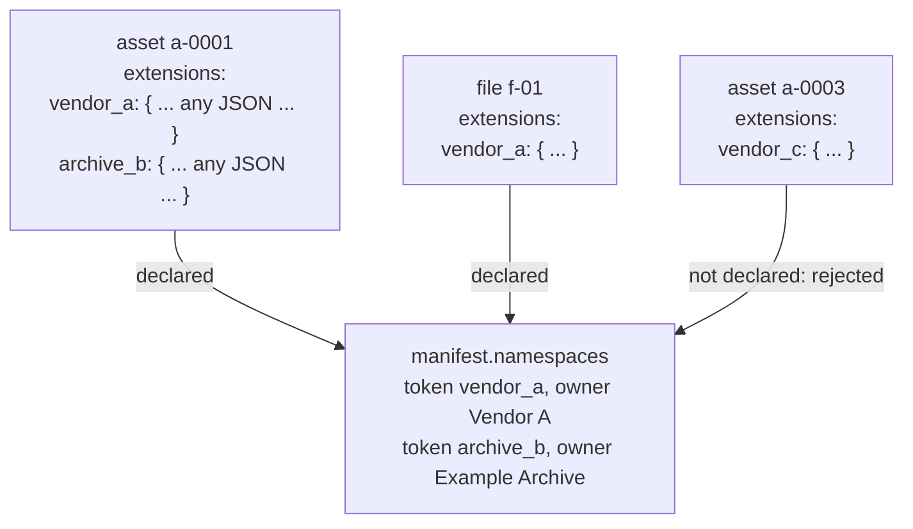

# OASIS 2.0 data model

Status: DRAFT 2.0.0-draft.2. Informative. The [contract](CONTRACT.md) and the [schema files](../../../definitions/) are normative. If a diagram and the contract disagree, the contract wins.
OASIS means Open Asset Standard Interchange Schema.

This document shows the shape of the model in pictures. Each diagram names the contract section it draws. Field lists show the field name and its JSON type. A field marked `req` is required. Dates are RFC 3339 strings. `ref` means a string that names another record's `id`.

## 1. The package

A package is one JSON document. It carries a manifest, three registries, and the asset records. Records point at registry entries by id and do not copy them, with one exception: an asset may carry a read-only copy of a collection record without `members`, which must equal the registry record. (Contract sections 3 and 4.)

Every record type shares one envelope (contract section 3):

## 2. A complete asset

Everything that can appear on one asset record. Nested objects belong to the asset and have ids unique inside it. The only outward links are references to registry records and to other assets. (Contract sections 7 to 13.)

How the pieces of one asset relate:

- **Files** are the bytes. Each file is in exactly one storage location at one path. A file may carry a role, such as master or preview, and a label. The role describes the file on its own and does not group it.
- **File groups** say which files belong together and why. A primary file group might hold one video file and two audio files, each a member with a track type and index. When one recording is split across several files, each file is a member with the same track type and index and its own segment index. A file can be in several file groups or none. Nothing is grouped by guesswork.
- **Versions** are states of the asset over time. Files, file groups, and annotations may say which version they belong to. A file with no version belongs to all of them.
- **Timing** gives the asset its timeline: a rational rate, a drop-frame flag, an optional source timecode for frame 0, and an optional length. Annotations and incoming subclip ranges are measured on it.
- **Annotations** are statements about the asset, optionally about a frame range or point.
- **Relationships** link this asset to another asset: derived from, subclip of, or variant of.
- **Metadata** values point at a definition in the registry and carry a value shaped by that definition.
- **Collections** on the asset are a convenience list. The collection record owns membership.
- **Access** is the one required access field: none, restricted, or unknown.

## 3. The registry records

Three record types live in the package registries and are referenced by assets and collections. (Contract sections 8, 10, 11.)

## 4. Membership: who owns the truth

The collection record owns membership. The asset-side list is a convenience that must agree. The completeness flags decide what absence means. (Contract section 10, rules COL-3 and COL-5.)

## 5. Time: frames, anchor, derived labels

Frame numbers are the authority. Seconds and timecode labels are derived for readers and must name the same frame. (Contract section 6.)

Rules in one line each: no default rate; a point has no end frame; start is inclusive and end is exclusive; drop-frame only at 30000/1001 and 60000/1001; labels only when an anchor exists and only at the rates in the contract table; a derived value that names a different frame is rejected.

## 6. Metadata: definitions apart from values

A definition is written once in the registry. Values on assets and collections point at it. The definition's value_type and cardinality decide the JSON shape of each value. (Contract section 11.)

## 7. Extensions and namespaces

Every record and most nested entities carry one `extensions` object. Its keys are namespace tokens. Every token used in a package is declared in the manifest with an owner. Unknown keys anywhere else are rejected. (Contract section 13.)

## 8. The six record types at a glance

| Type | Lives in | Required beyond the envelope | Points at |
| --- | --- | --- | --- |
| `package` | document root | `manifest` | everything below |
| `asset` | `assets[]` or standalone | `title`, `access` | storage locations, metadata definitions, collections, other assets |
| `collection` | `collections[]` or standalone | `title`, `collection_kind`, `access` | parent collection, storage location, assets, metadata definitions |
| `storage_location` | `storage_locations[]` or standalone | `name`, `system` | nothing |
| `metadata_definition` | `metadata_definitions[]` or standalone | `value_type`, `cardinality` | nothing |
| `annotation` | `asset.annotations[]` as a nested object, or standalone | `purpose`, and `asset` when standalone | its asset, a version, metadata definitions |
