# OASIS 2.0 data model

Status: DRAFT 2.0.0-draft.4. Informative. The [contract](CONTRACT.md) and the [schema files](../../../definitions/) are normative. If a diagram and the contract disagree, the contract wins.
OASIS means Open Asset Standard Interchange Schema.
The [glossary](GLOSSARY.md) defines the terms used here.

This document shows the shape of the model in pictures. Each diagram names the contract section it draws. Field lists show the field name and its JSON type. A field marked `req` is required. Dates are RFC 3339 strings. `ref` means a string that names the `id` of another record or of a nested object.

## 1. The package

A package is the only exchange document. It has a manifest and four record lists: `storage_locations`, `metadata_definitions`, `collections`, and `assets`. Each record list is optional. A single-document package is one JSON document, and the diagrams in this section draw it. A multi-file package holds the same parts in a package folder (section 9). Every reference resolves inside the package, so a package holds every record that its references need. Records point at other records by id and never copy them. (Contract sections 3, 4, and 5.)

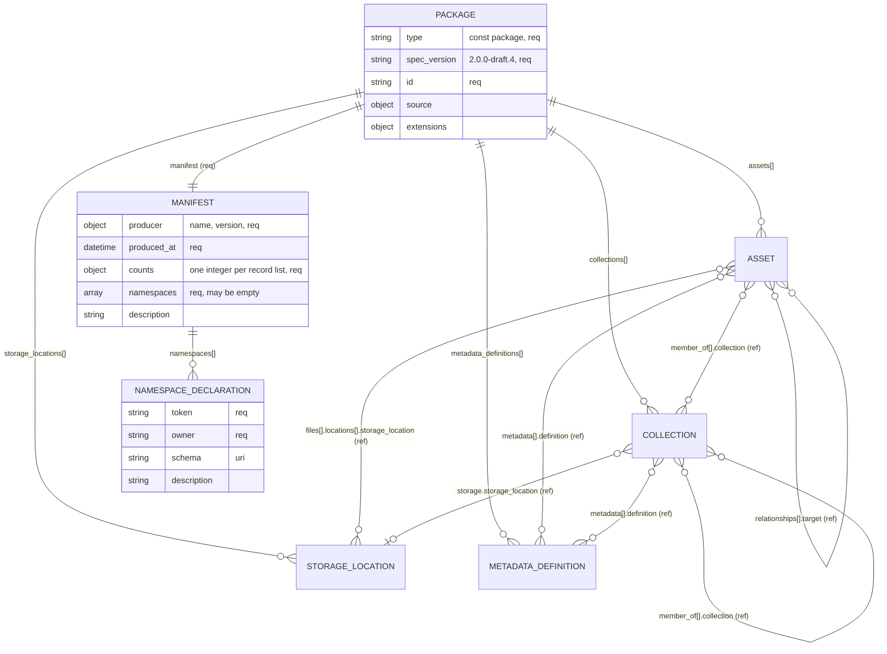

The edges show references. The membership edges start at the member: an asset or a collection names the collections it belongs to. A collection does not list its members.

Only the package root carries `type` and `spec_version`. A record inside a package carries neither field. The record list that holds a record states its type. A `type` or `spec_version` key on a record is an unknown key, and the schema rejects it. (Contract section 3, `REC-1`, `REC-2`, `REC-7`.)

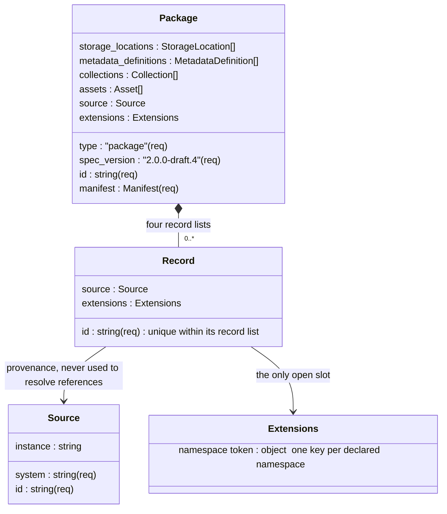

The package describes its records as they stood at `produced_at`. It carries no command. A missing record, field, or value is not an instruction to delete or clear anything (`PKG-9`).

## 2. A complete asset

Everything that can appear on one asset record. Nested objects belong to the asset. Their ids are unique inside the asset, across the asset level, every version, and `unassigned`. The outward links are references to other records in the package. (Contract sections 6 to 13.)

### 2.1 Asset, versions, and holders

An asset with no versions holds its items at the asset level. An asset with versions places each item with its owner: a version, the asset level, or `unassigned`. The object that holds an item is its holder, and the holder states the version. No item carries a version field. (Contract section 9, `VER-1` to `VER-7`.)

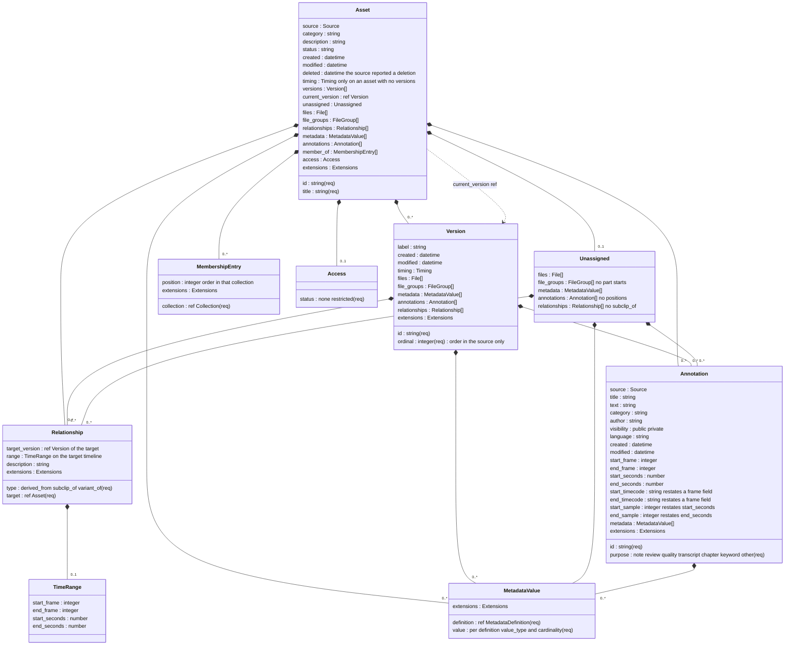

The asset, each version, and `unassigned` also hold `files` and `file_groups`. Section 2.2 draws them. `timing` sits on an asset with no versions or on a version. Section 5 draws it.

### 2.2 Files, copies, and file groups

A file is one content item. Its `locations` list the stored copies that the source reports. A file group selects files of the same holder and states the track of each one. (Contract section 8.)

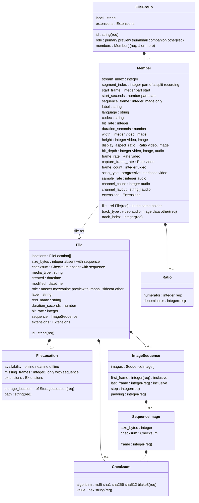

How the pieces of one asset relate:

- **Files** are content items. A file lists its stored copies in `locations`. Each entry names one storage location and the `path` of the copy there, and may state its `availability`. Several entries claim identical bytes, so `size_bytes`, `checksum`, and the technical fields describe every copy. A copy is not a rendition and not a version. A file may carry a role, such as master or preview, and a label. The role describes the file on its own and does not group it. An absent or empty `locations` means that no copy is known (`FILE-6`).
- **Image sequences** have two forms. A compact sequence is one file with `sequence`: it stands for the images from `first_frame` to `last_frame` in steps of `step`, with both ends included. Each `path` holds the text `{frame}` once. Such a file has no `size_bytes` and no `checksum` (`FILE-8`). An explicit sequence is one file per image, and each image is a member with `sequence_frame` (`GRP-12`).
- **File groups** say which files belong together and why. A primary file group might hold one video file and two audio files, each a member with a track type and index. A member may name the stream in its file with `stream_index` and describe that stream with the track fields (`GRP-10`, `GRP-11`). When one recording is split across several files, each file is a member with the same track type and index and its own segment index. A segment may state its part start on the holder timeline (`GRP-7`). A file group names files of its own holder only. A file can be in several file groups or none. Nothing is grouped by guesswork.
- **Versions** are states of the asset in the source. A version holds its own timing, files, file groups, metadata, annotations, and relationships. `ordinal` gives the order in the source only and never selects the current version. `current_version` names the current version when the source states it. When it is absent, the current version is unknown (`VER-6`). An asset with no versions has one implied original version.
- **Unassigned** holds what the source holds for one of the versions without naming which. It is not a version and has no timeline (`VER-5`).
- **Timing** gives a timeline to an asset with no versions, or to a version. It has a frame form and a seconds form (section 5). Annotation positions and part starts are measured on the timeline of their holder.
- **Annotations** are statements about the asset, optionally about a point or a range on the holder timeline. `visibility` states who can see the annotation in the source: `public` or `private`. Absence means unknown (`ANN-4`).
- **Relationships** link this asset to another asset: derived from, subclip of, or variant of. A `range` lies on the target timeline: the timeline of the version that `target_version` names, or of the target asset when it has no versions (`REL-6`).
- **Metadata** values point at a definition in the `metadata_definitions` record list and carry a value shaped by that definition. One metadata field sits at one level of an asset only (`VER-7`).
- **Membership** is on the member. `member_of` lists the collections that the asset belongs to, each with an optional `position` (section 4).
- **Access** is optional: `none` or `restricted`. An absent `access` means that the package supplies no access information. Absence never means `none` (`ACC-1`, `ACC-2`).
- **Deleted** states that the source reported the asset deleted at that date-time. It is a fact about the source, not an instruction to delete (`AST-3`).

## 3. Storage locations, metadata definitions, and collections

Three record lists hold the records that assets and collections reference. (Contract sections 8, 10, and 11.)

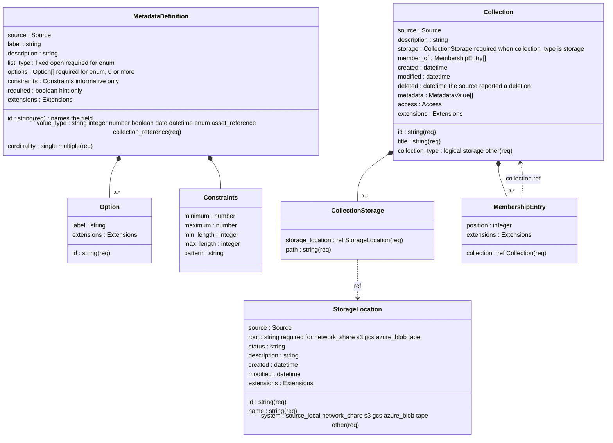

A storage location record describes one place. It has no connection settings and no credential fields (`STO-2`). `root` and `path` join under the `STO-3` table. Two places on one storage system are two records.

A saved search is not a collection in OASIS (`COL-2`).

A collection may carry `deleted`. As on an asset, it states that the source reported the collection deleted at that date-time. It is a fact about the source, not an instruction to delete the collection or its members (`COL-8`).

## 4. Membership: the member owns the truth

Membership is recorded on the member. An asset or a collection lists the collections it belongs to in `member_of`. A collection record does not list its members. The members of a collection are the assets and collections in the package that name it. (Contract section 10, `COL-3`, `COL-4`, `COL-7`.)

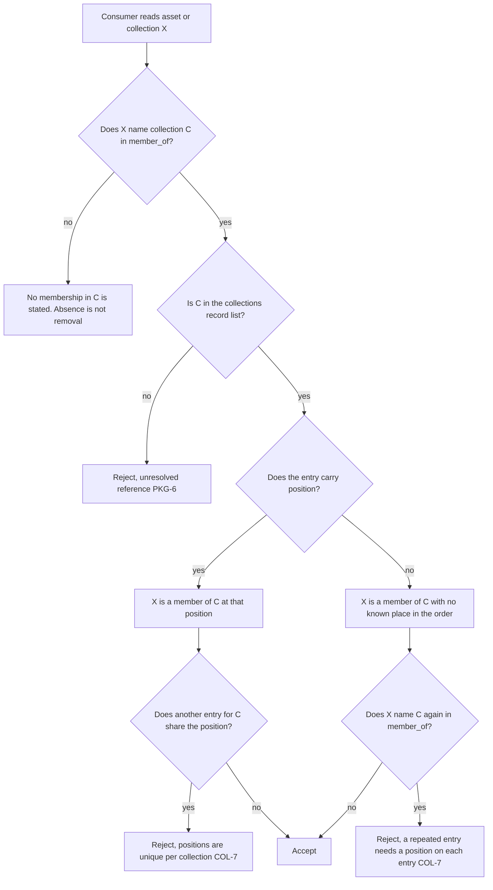

- A collection may belong to several collections. Membership among collections never forms a cycle. A collection that names itself is a cycle (`COL-4`).
- All entries that name one collection, from assets and collections together, share one position scope. Positions are integers, compare by value, and need not be consecutive. Array order and record order give no order (`COL-7`, `PKG-8`).
- An absent and an empty `member_of` both state no membership. Neither states non-membership. The collection may have other members in the source that this package does not hold (`COL-3`).

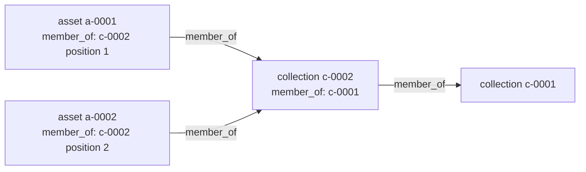

## 5. Time: two forms of timing

A `timing` object defines one timeline. It has one of two forms. In the frame form, frames define each position, and seconds and timecode labels restate them. In the seconds form, elapsed seconds define each position. Either form may declare `sample_rate`, and sample positions then restate seconds. (Contract section 6.)

### 5.1 Frame form

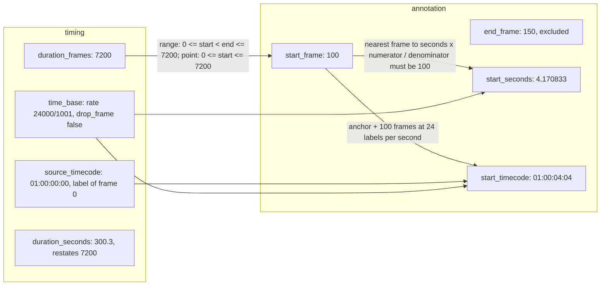

### 5.2 Seconds form

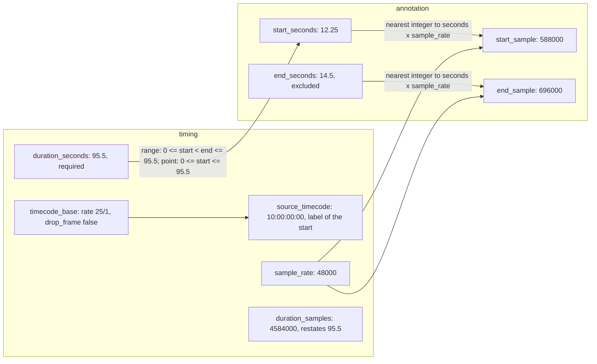

Rules in one line each:

- There is no default rate. A frame field needs frame-form timing on its holder.
- The frame form has `time_base`. `duration_frames` is optional, and `duration_seconds` restates it. The seconds form has no `time_base` and requires `duration_seconds`.
- A variable-frame-rate asset uses the seconds form, with no frame fields (`TIME-10`).
- A range includes its start and excludes its end, in either unit. A point has no end.
- A position equal to the length is the end boundary. A point may sit there. A range ends there at the latest. A part start is strictly less than the length.
- Drop-frame is allowed only at 30000/1001 and 60000/1001.
- Timecode labels on markers need a frame field and a `source_timecode`, and only at the rates in the contract table. In the seconds form, `source_timecode` needs `timecode_base`, and markers carry no labels.
- A restated value that names a different frame or sample is rejected.
- The asset level of an asset with versions and `unassigned` have no timeline. They hold no position, no part start, and no `subclip_of`.

## 6. Metadata: definitions apart from values

A definition is written once in the `metadata_definitions` record list. Values on assets, versions, `unassigned`, collections, and annotations point at it. The definition's value_type and cardinality decide the JSON shape of each value. An `enum` definition has a list type. A `fixed` list accepts only option ids. An `open` list accepts any string, and an item equal to an option id is that option. In a `multiple` value, each item appears at most once. (Contract section 11, `MD-7`, `MD-8`.)

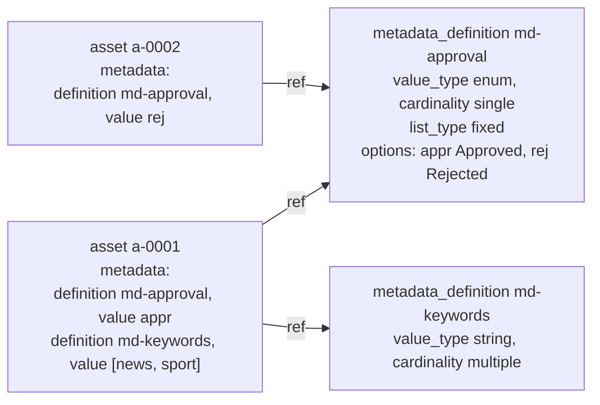

## 7. Extensions and namespaces

Every record and most nested entities carry one `extensions` object. This includes file location entries and membership entries. Its keys are namespace tokens. Every token used in a package is declared in the manifest with an owner. Unknown keys anywhere else are rejected. A consumer that re-emits a record keeps every extension value that it does not interpret, by value (`EXT-4`). (Contract section 13.)

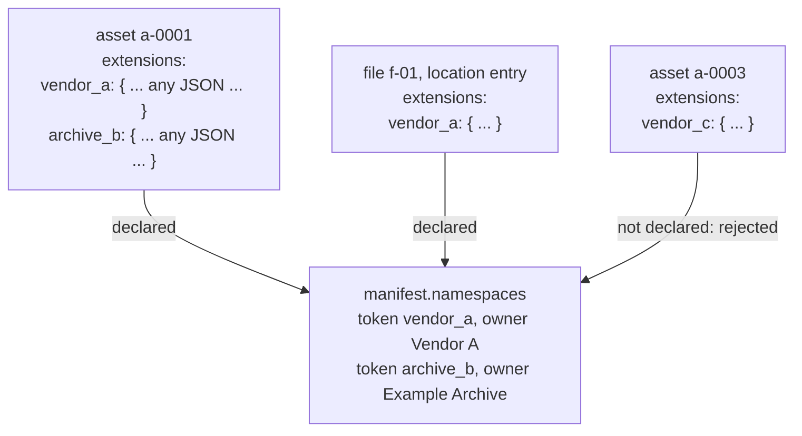

## 8. The package and its record lists at a glance

| Type | Lives in | Required beyond `id` | Points at |
| --- | --- | --- | --- |
| `package` | document root | `type`, `spec_version`, `manifest` | everything below |
| asset | `assets[]` | `title` | storage locations, metadata definitions, collections, other assets and their versions |
| collection | `collections[]` | `title`, `collection_type` | collections it belongs to, storage location, metadata definitions |
| storage location | `storage_locations[]` | `name`, `system` | nothing |
| metadata definition | `metadata_definitions[]` | `value_type`, `cardinality` | nothing |

An annotation is a nested object, never a record. It sits in an `annotations` list at the asset level, in a version, or in `unassigned` (`ANN-1`).

## 9. The multi-file package

A multi-file package holds one package in a package folder. The manifest file `oasis-package.json` holds the package root. Its manifest lists the member files in `members`. The root has none of the four record arrays. Member files hold the records, one complete record on each line. Each record folder holds the member files of one record type. The records are the same as in a single document. (Contract section 16, `MFP-1` to `MFP-9`.)

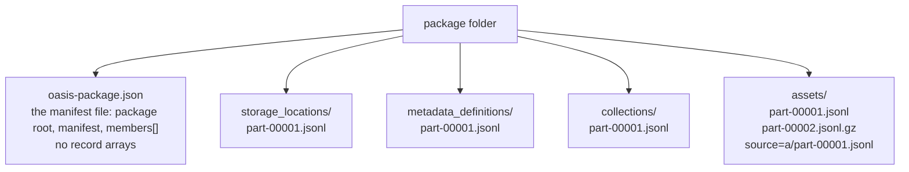

A record folder may hold subfolders. Member file names are free, but each name ends in `.jsonl` or `.jsonl.gz`. A record folder may be absent when its list is absent. A file in a record folder that the manifest does not list makes the package invalid (`MFP-3`).

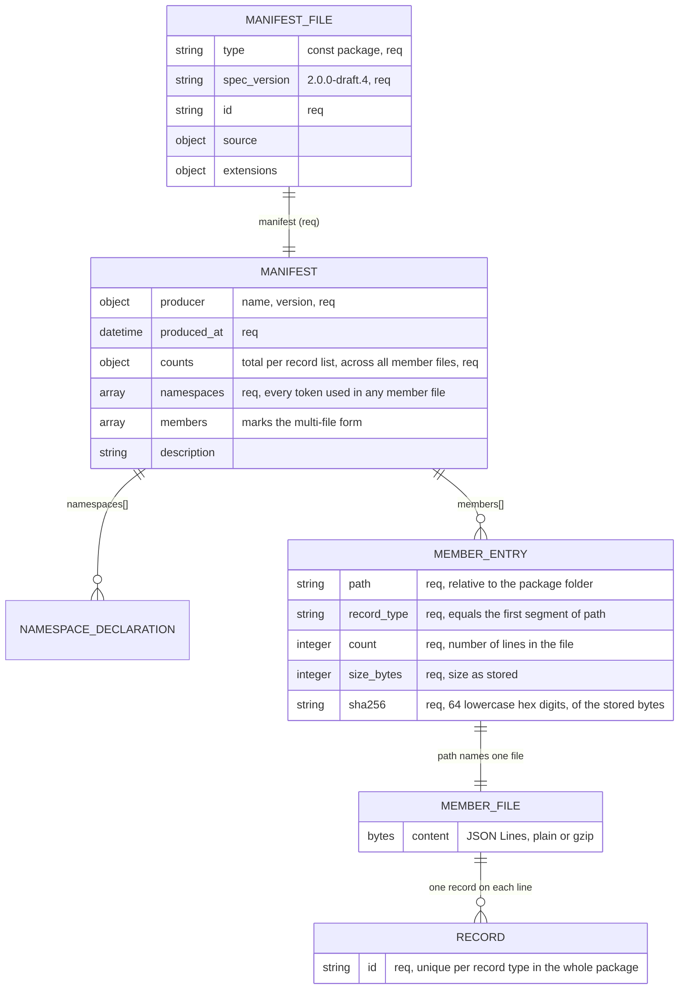

Rules that the diagrams show:

- `record_type` states the type of every record in the file. A line carries no `type` and no `spec_version` (`MFP-2`, `REC-1`).
- Every line ends with one LF, the last line too. No CR, no blank line, no byte-order mark, and no space (U+0020) or tab (U+0009) before or after the object (`MFP-4`).
- A `.jsonl.gz` file is a gzip stream. Its compressed size is `size_bytes`, and its compressed bytes give `sha256` (`MFP-2`, `MFP-4`).
- Each `counts` value is the sum of the member counts of its record type (`MFP-5`, `PKG-3`).
- A list is absent when no member entry has its record type. It is empty when its member counts total 0 (`MFP-6`).
- References, identifier uniqueness, collection positions, and namespace declarations apply across all member files. A record may reference a record in a later file (`MFP-7`).
- The order of `members` and of lines carries no meaning. A checker uses manifest order, then line order, only to choose which repeat it reports (`MFP-7`, `PKG-8`).
- The producer writes the member files first and the manifest file last (`MFP-8`).

A single document and a multi-file package with the same root, the same present and absent lists, and the same records are equivalent. When each record list keeps its record order, a checker gives both the same outcome and the same findings (`MFP-9`).
